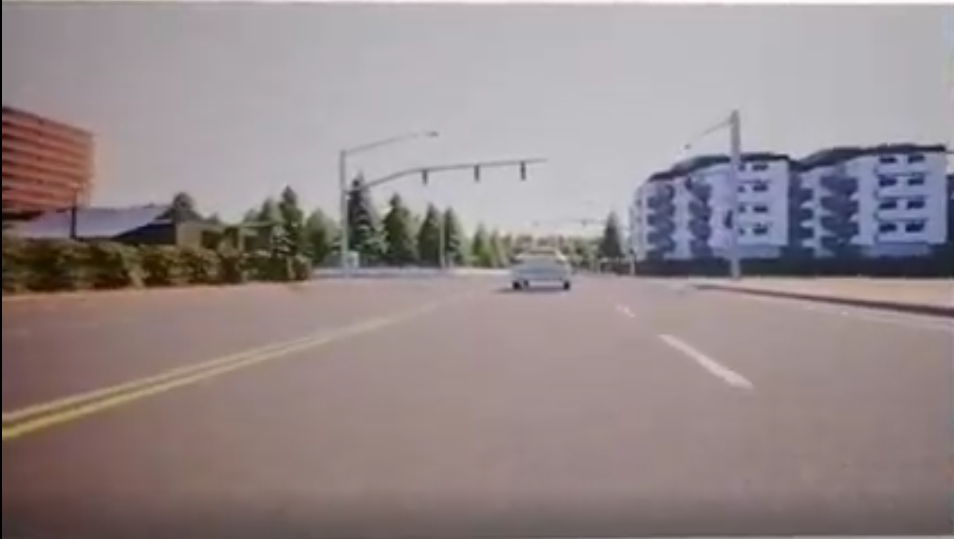
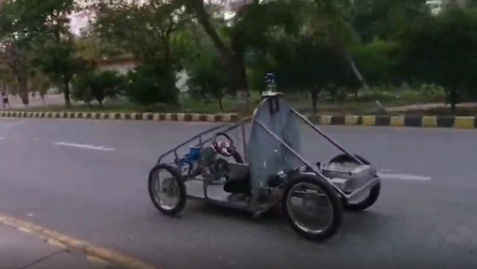

# 🚗 Autonomous Vehicle Project

A comprehensive autonomous vehicle system featuring both **reinforcement learning training** in CARLA simulator and **real-time autonomous driving** with computer vision and hardware control.

This project demonstrates end-to-end autonomous vehicle development, from training deep RL models in simulation to deploying them on physical hardware with camera-based perception.

---

## 🎥 Demonstrations

### CARLA Training in Action

[](https://drive.google.com/file/d/1v8xVtIwlTS2S_kr9NU4cn8CIjT83k0tj/view?usp=sharing)

**[▶️ Watch Full Video](https://drive.google.com/file/d/1v8xVtIwlTS2S_kr9NU4cn8CIjT83k0tj/view?usp=sharing)**

*Video: Reinforcement learning training process in CARLA simulator showing the agent learning to drive autonomously.*

---

### Realtime Car in Action

[](https://drive.google.com/file/d/1id-O2ufc2Q-v6Jwf3EZD7nZkNPAcpKyP/view?usp=sharing)

**[▶️ Watch Full Video](https://drive.google.com/file/d/1id-O2ufc2Q-v6Jwf3EZD7nZkNPAcpKyP/view?usp=sharing)**

*Video: Real-time autonomous vehicle system in action, using camera-based lane detection and object detection with ESP32 motor control.*

---

## 📊 Presentation

**[📄 View Full Presentation](https://drive.google.com/file/d/1id-O2ufc2Q-v6Jwf3EZD7nZkNPAcpKyP/view?usp=sharing)**

Complete project presentation covering architecture, methodology, training process, and real-world deployment.

---

## 📁 Project Structure

```
Autonomous-Vehicle/
│
├── README.md                    # This file - project overview
│
├── rl_training_carla/          # Reinforcement Learning Training Module
│   ├── README.md               # Detailed RL training documentation
│   ├── train.py                # Main training script
│   ├── play.py                 # Test trained models
│   ├── settings.py             # Training configuration
│   ├── sources/                # Core RL implementation
│   │   ├── models.py           # Neural network architectures (5-layer residual CNN)
│   │   ├── agent.py            # RL agent implementation
│   │   ├── trainer.py          # DQN training logic
│   │   ├── carla.py            # CARLA environment wrapper
│   │   └── ...                 # Additional modules
│   └── requirements.txt        # Python dependencies
│
└── realtime_autonomous_vehicle/ # Real-Time Autonomous Driving Module
    ├── README.md               # Detailed realtime system documentation
    ├── play.py                 # Main autonomous driving script
    ├── camera_pkls/            # Camera calibration files
    │   ├── calib.p             # Camera matrix and distortion coefficients
    │   └── maps.p              # Perspective transform data
    ├── Hardware/               # ESP32 motor control system
    │   ├── Arduino_Codes/      # Firmware for ESP32 modules
    │   │   ├── accel.ino       # Acceleration module
    │   │   ├── brake.ino       # Braking module
    │   │   ├── steer.ino       # Steering module
    │   │   └── speed.ino       # Speed sensor
    │   └── tests/              # Hardware testing utilities
    └── requirements.txt        # Python dependencies
```

---

## 🎯 Overview

This project consists of two main components:

### 1. **RL Training in CARLA** (`rl_training_carla/`)

Train deep reinforcement learning models for autonomous driving in the CARLA simulator:

- **Architecture**: Asynchronous Real-Time DQN (ARTDQN) with 5-layer residual CNN
- **Training**: Multiple parallel agents collect experiences, centralized trainer updates model
- **Environment**: CARLA 0.9.6 simulator with realistic driving scenarios
- **Features**:
  - Multi-agent parallel training for faster learning
  - Experience replay buffer
  - Target network for stable Q-learning
  - TensorBoard integration for monitoring
  - Checkpoint saving and resume capability

**Quick Start:**
```bash
cd rl_training_carla
# Configure settings.py with CARLA path
python train.py
```

See [`rl_training_carla/README.md`](rl_training_carla/README.md) for detailed documentation.

---

### 2. **Realtime Autonomous Vehicle** (`realtime_autonomous_vehicle/`)

Real-time autonomous driving system using computer vision and hardware control:

- **Perception**: 
  - Advanced lane detection using polynomial fitting
  - YOLOv8 object detection (cars, pedestrians, signs, traffic lights)
- **Control**: ESP32-based motor control for steering, acceleration, and braking
- **Decision Making**: Real-time path planning and obstacle avoidance
- **Features**:
  - Camera calibration and perspective transform
  - Distance estimation to detected objects
  - Collision avoidance logic
  - UART communication with ESP32 modules

**Quick Start:**
```bash
cd realtime_autonomous_vehicle
# Calibrate camera first (see README)
# Upload ESP32 firmware (optional, for hardware control)
python play.py --video 0 --esp
```

See [`realtime_autonomous_vehicle/README.md`](realtime_autonomous_vehicle/README.md) for detailed documentation.

---

## 🔄 Workflow

### Development Pipeline

1. **Training Phase** (`rl_training_carla/`):
   - Train RL models in CARLA simulator
   - Experiment with different architectures and hyperparameters
   - Monitor training progress via TensorBoard
   - Save model checkpoints

2. **Deployment Phase** (`realtime_autonomous_vehicle/`):
   - Use trained models OR classical CV approaches
   - Deploy on physical hardware with camera
   - Integrate with ESP32 motor controllers
   - Test in real-world scenarios

### Integration Possibilities

While the two modules are currently separate, they can be integrated:
- Deploy trained RL models from CARLA to the realtime system
- Use real-world data from the realtime system to improve training
- Transfer learning between simulation and reality

---

## 🛠️ Technology Stack

### RL Training Module
- **Python 3.7**
- **TensorFlow 1.13.1** + **Keras 2.2.4**
- **CARLA 0.9.6** simulator
- **NumPy**, **OpenCV**

### Realtime Module
- **Python 3.x**
- **OpenCV** (computer vision)
- **Ultralytics YOLO** (object detection)
- **PySerial** (ESP32 communication)
- **TensorFlow/PyTorch** (if using trained models)

---

## 📋 Requirements

### RL Training
- Python 3.7
- CARLA 0.9.6 (download from [carla.org](https://carla.org/releases/))
- GPU recommended (CUDA-compatible)
- See [`rl_training_carla/requirements.txt`](rl_training_carla/requirements.txt)

### Realtime System
- Python 3.x
- Camera (USB/webcam) or video files
- ESP32 modules (optional, for hardware control)
- See [`realtime_autonomous_vehicle/requirements.txt`](realtime_autonomous_vehicle/requirements.txt)

---

## 🚀 Getting Started

1. **Choose your module:**
   - For RL training: See [`rl_training_carla/README.md`](rl_training_carla/README.md)
   - For realtime driving: See [`realtime_autonomous_vehicle/README.md`](realtime_autonomous_vehicle/README.md)

2. **Install dependencies:**
   ```bash
   # For RL training
   cd rl_training_carla
   pip install -r requirements.txt
   
   # For realtime system
   cd realtime_autonomous_vehicle
   pip install -r requirements.txt
   ```

3. **Follow the setup instructions** in each module's README

---

## 📚 Documentation

- **[RL Training Documentation](rl_training_carla/README.md)** - Complete guide to training RL models in CARLA
- **[Realtime System Documentation](realtime_autonomous_vehicle/README.md)** - Guide to the real-time autonomous driving system

---

## 🎓 Learning Resources

- **CARLA Simulator**: https://carla.org/
- **Deep Q-Networks (DQN)**: Standard RL algorithm for discrete action spaces
- **Computer Vision**: OpenCV and YOLO for perception

---

## ⚠️ Important Notes

- The RL training module requires CARLA 0.9.6 specifically (older version for compatibility)
- The realtime system requires camera calibration before use
- Hardware control (ESP32) is optional - system can run with video files
- Training in CARLA can take many hours/days depending on hardware

---

## 📄 License

See individual module LICENSE files for details.

---

## 🤝 Contributing

This is a research/educational project demonstrating autonomous vehicle development from simulation to reality.

